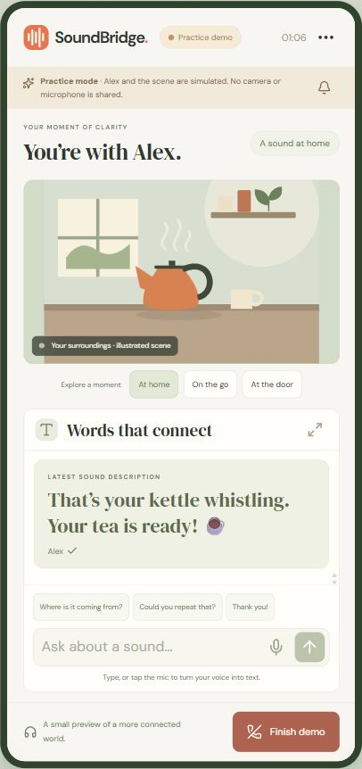
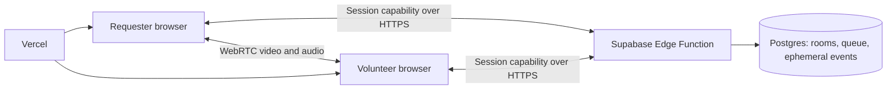

# SoundBridge

**A little sound. A lot of connection.**

A phone-first web app connecting Deaf and hard-of-hearing people with community volunteers who describe everyday sounds through video and text. Built for **SASEHacks for Good**, October 24, 2026.

**[Open the live app](https://soundbridge-sasehacks.vercel.app)**

[Judging slides](presentation/SoundBridge-judging.pptx) · [Demo script](docs/DEMO.md) · [Devpost draft](docs/DEVPOST_DRAFT.md)

For an offline slideshow without PowerPoint, open `presentation/index.html` in a browser. Keep its `slides` folder beside it. Use the arrow keys to advance.

## Try it in a minute

Click **Feel the connection** for a guided, explicitly simulated conversation. Explore a kettle, a station announcement, or a doorbell. Try a quick reply, the persistent visual attention signal, and the text focus button. The practice volunteer and scenes are scripted, not AI sound detection.

For a **real connection**, open the app in two tabs or on two devices:

1. On the first device, choose **I need a hand → Find a volunteer**.
2. Enter a nickname, optionally enable camera and microphone, accept the participation notice, and start.
3. On the second device, choose **I can help → Be someone’s ears** and follow the same check.
4. The app matches the two roles. The requester’s sound reaches the volunteer through WebRTC. The volunteer types a description or uses the microphone button to dictate a draft, reviews it, and sends it as text.
5. Try a quick reply and **Attention**. End the call from either side. Save a transcript before leaving the summary if you want a copy.

Use **Invite someone you know** while waiting to create a private link and QR code instead of joining the random queue. Anyone with that link can occupy its single volunteer slot. Invitations expire after 30 minutes.

Use headphones when testing both sides in the same room to avoid feedback. The volunteer’s call microphone starts muted, while the requester’s microphone starts enabled when audio permission is granted. Each participant controls their own camera and microphone.

## What works

- Atomic random matching between the two roles, with queue heartbeats and stale-request expiry.
- One-use private invitations with a locally generated QR code.
- Real WebRTC camera and audio streaming, camera switching, and media controls.
- Authenticated call text and signaling through Supabase Edge Functions, with polling roughly once per second.
- Browser speech recognition for voice-to-text drafts, plus typed messages and quick replies.
- Large latest-description area, text focus mode, configurable text sizes, higher contrast, keyboard support, and reduced-motion support.
- Persistent visual attention cues and vibration on supported devices.
- Report-and-leave, call summaries, optional transcript downloads, and device-local history.
- Responsive layouts for phones, tablets, and laptops.



## Run locally

Requires Node.js 22.12+ or a current Node.js 24 release.

```sh
npm ci
npm run dev
```

Open the localhost address printed by Vite. If port 5173 is occupied, Vite chooses the next available port. The default public configuration connects to the deployed hackathon backend; no secret is needed to try the app. HTTPS or localhost is required for camera, microphone and WebRTC features. A phone visiting a plain HTTP LAN address may be unable to use its devices, so use the HTTPS deployment for the phone demo.

```sh
npm run build
npm run preview
npm test
```

The integration tests contact the demo backend and create clearly named QA sessions. They verify input validation, credential rejection, matching, private room access, message delivery, signaling, call cleanup, one-use invitations, reporting, and browser denial at the database layer.

The local-only pages `tests/media-lab.html` and `tests/phone-lab.html` provide generated camera streams and a 390 × 844 phone viewport for manual QA. The media lab never opens a physical camera or microphone. Vite does not include these test pages in the production build.

## Architecture

React + TypeScript render the client, Vite builds it, and Vercel serves the HTTPS app. Supabase hosts Postgres and the `soundbridge` Edge Function. WebRTC carries call media. The Edge Function carries text, signaling, and call-control events through authenticated HTTP requests.



An unpredictable session capability authenticates a guest without requiring an email address. The backend stores only its SHA-256 hash. Every room action checks participant membership. The client receives only a publishable API key. RLS and revoked table grants prevent browser clients from reading session records or events directly. Database functions use invoker privileges and are executable only by the service role inside the Edge Function.

Matching and invitation claims run in Postgres transactions. Appending an event and ending a call lock the same room row, so an event racing with call termination cannot remain after cleanup. The client adds a sent message to its log only after the server acknowledges it.

## Privacy and prototype limits

- The application never records call video or audio. A volunteer can still use their device to take a screenshot or recording, so this is not a guarantee against participant capture.
- Text and connection events are temporary server records during the call. Ending the call clears them. API access expires after a maximum 30-minute room lifetime. Physical cleanup of abandoned records is opportunistic, triggered by later API activity. Display names and hashed guest sessions expire after four hours and are removed during cleanup. Reports remain for review.
- Preferences, helpfulness responses, and recent-call metadata stay in the current browser. Conversation text is not stored in history. Downloads are an explicit local action.
- Voice typing is browser-dependent, works best in Chrome or Edge, and may use the browser vendor’s speech service. It produces an editable draft, not a guaranteed transcription.
- The demo ships with public STUN servers. Video can fail on restrictive Wi-Fi or cellular NAT without a TURN relay; text continues to work. `VITE_ICE_SERVERS` can configure a relay. Use short-lived credentials for a public service.
- This prototype has guest identities, not verified volunteer accounts. Reports have no staffed moderation team. It is not an emergency service, professional interpreting service, or a source of medical or safety decisions.
- Before a public pilot: co-design with Deaf and hard-of-hearing participants, screen volunteers, staff moderation, add application and IP rate limits, schedule retention cleanup, provide managed TURN, and test on physical iOS and Android devices.

## Deploy your own backend

Create a Supabase project, run `supabase/schema.sql` once in its SQL editor, and deploy `supabase/functions/soundbridge/index.ts` as the `soundbridge` Edge Function. Disable the gateway’s JWT requirement for this function because it authenticates its own guest capabilities. Keep `SUPABASE_SERVICE_ROLE_KEY` only in the Edge Function environment. Supabase provides its reserved project secrets there automatically.

Copy `.env.example` to `.env.local` and set your own URL and publishable key. Update the `connect-src` hosts in `vercel.json` to your project. Deploy the Vite app to Vercel with `npm run build` and output directory `dist`. Never put a Supabase secret or service-role key in a `VITE_` variable.

## Judging and submission

The presentation notes and demo sequence are in `docs/DEMO.md`. The Devpost copy in `docs/DEVPOST_DRAFT.md` is a draft for the team to review. **Creating the app and repository does not submit the project to Devpost.**

Judging instructions supplied by the organizers: **5:15 PM, Gallogly Hall, Room 127**. The repository link for the submission is [Jaxonize/soundbridge-sasehacks](https://github.com/Jaxonize/soundbridge-sasehacks).

## License

MIT. Application source was authored during this hackathon build. Open-source dependencies retain their own licenses.
